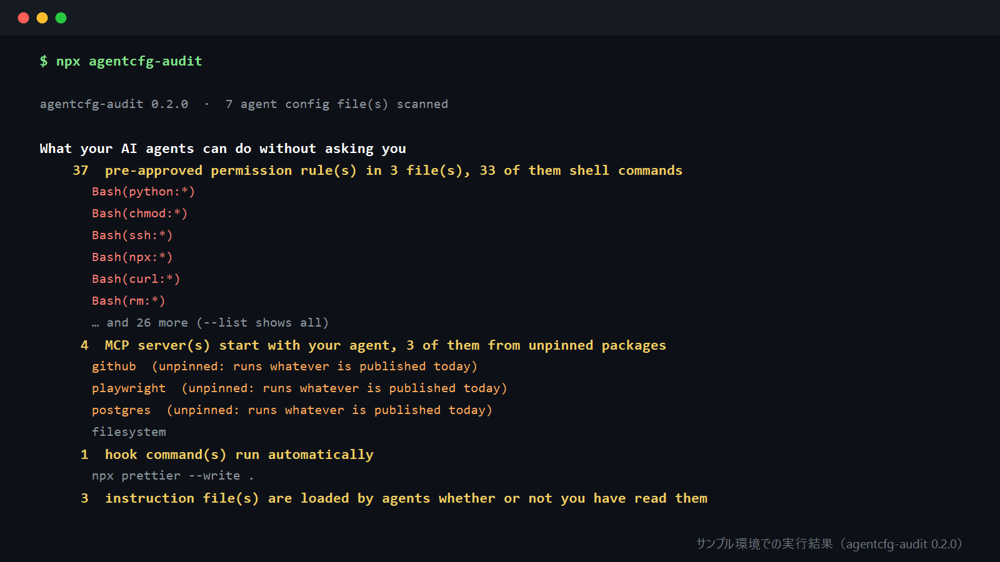

# agentcfg-audit

**For people who use Claude Code or Cursor and have clicked "don't ask again".**

Every approval you gave stays until you remove it. If your agent reads a malicious file or web
page and follows instructions hidden in it, approved commands run with no prompt. With `curl` or
`rm` approved, that can mean:

- your API keys or files get sent somewhere
- your files get deleted

Most people don't remember what they approved. This lists it.

## Try it

Ask your agent:

```text
Run npx github:refu15/agentcfg-audit --global and explain the results
```

Or run it yourself:

```bash
npx github:refu15/agentcfg-audit --global
```



*Output from a sample setup.*

It shows, every time:

- every pre-approved command, broadest first (`curl`, `rm`, `ssh`…)
- MCP servers that start with your agent, and which ones download whatever is published today
- hooks that run automatically
- instruction files your agent reads whether or not you have
- API keys left in config files, and other risky settings, with how to fix them

It only reads files. No network calls, no dependencies, nothing is changed.
With `--global`, projects Claude Code has opened are looked up from `~/.claude.json`, so approvals
saved in each project's `.claude/settings.local.json` are counted too.

To remove an approval, you can ask your agent too: *"Remove the curl and rm approvals from my settings."*

## What it checks

| ID | Severity | Finding |
|----|----------|---------|
| SEC001 | high | Known credential formats in any agent file (Anthropic, OpenAI, GitHub, AWS, Slack, Google, GitLab, npm, Stripe, JWT, private keys, URLs with passwords) |
| SEC002 | medium | High-entropy literal in a secret-looking `env` / `headers` key |
| MCP001 | medium | MCP server launched from an unpinned package (`npx -y pkg`, `uvx pkg`, `pnpm dlx`, git URL without commit) |
| MCP002 | high | MCP server command downloads or decodes code and executes it (`curl … \| sh`, `base64 -d`) |
| MCP003 | medium | Remote MCP server over plain `http://` |
| MCP004 | medium | Filesystem MCP server scoped to `/`, a drive root or the whole home directory |
| MCP005 | high | MCP container with `--privileged`, `docker.sock` or root filesystem mount |
| MCP006 | low | MCP container image on a floating tag |
| CC001 | high | Claude Code `defaultMode: bypassPermissions` |
| CC002 | high | Allow rule for unrestricted shell (`Bash`, `Bash(*)`) |
| CC003 | medium | Wildcard allow rule for an arbitrary-execution command (`Bash(curl:*)`, `Bash(python:*)`, `Bash(sudo:*)`…) |
| CC004 | medium | `enableAllProjectMcpServers` (any cloned repo can start MCP servers) |
| CC005 | high/medium | `ANTHROPIC_BASE_URL` / `OPENAI_BASE_URL` pointing at a third-party host |
| CC006 | high | `apiKeyHelper` defined in repository settings |
| CC007 | high | Hook command that uses the network, credential files or obfuscated code |
| CC008 | low | Repository ships an auto-running hook (review it) |
| CX001 | high/medium | Codex `sandbox_mode = "danger-full-access"` (high with `approval_policy = "never"`) |
| INJ001 | high | Invisible Unicode tag characters in a rule file (hidden text is decoded and shown) |
| INJ002 | high | Bidirectional control characters |
| INJ003 | medium | Zero-width characters |
| INJ004 | high | "Ignore previous instructions"-style override |
| INJ005 | high | Instruction to hide actions from the user |
| INJ006 | high | Credential file + network command on one line |
| INJ007 | medium | Download-and-execute command in a rule file |
| INJ008 | medium | HTML comment (invisible when rendered) containing agent-directed instructions |
| INJ009 | medium | Slash command / skill with `allowed-tools: Bash` |

## Files it reads

**Project** (default, recursive from the given path): `.mcp.json`, `.cursor/mcp.json`, `.vscode/mcp.json`,
`.claude/settings*.json`, `.gemini/settings.json`, `.codex/config.toml`, `CLAUDE.md`, `AGENTS.md`,
`GEMINI.md`, `.cursorrules`, `.cursor/rules/*.mdc`, `.windsurfrules`, `.clinerules`,
`.github/copilot-instructions.md`, `.github/instructions/*.md`, `.claude/{commands,agents,skills}/**/*.md`.

**User level** (`--global`): `~/.claude.json`, `~/.claude/settings.json`, `~/.claude/{commands,agents,skills}`,
Claude Desktop `claude_desktop_config.json`, `~/.cursor/mcp.json`, Windsurf `mcp_config.json`,
`~/.gemini/settings.json`, `~/.codex/config.toml`, VS Code / Cursor user `mcp.json`.

## Usage

```bash
npx github:refu15/agentcfg-audit                 # audit the current repository
npx github:refu15/agentcfg-audit --global        # …plus your user-level agent configs
npx github:refu15/agentcfg-audit --global-only   # only your machine, no repository
npx github:refu15/agentcfg-audit path/to/repo --fail-on medium
npx github:refu15/agentcfg-audit --ignore CC008,MCP006 --json
```

Exit code is `1` when a finding at or above `--fail-on` (default `high`) exists, `2` on usage errors.

### Before you open a repository you just cloned

```bash
npx github:refu15/agentcfg-audit ./that-repo --fail-on low
```

Repository-level agent files (`.mcp.json`, `.claude/settings.json`, rule files) are an attack surface:
they are applied the moment you start an agent in that directory.

### GitHub Actions

```yaml
name: agent-config-audit
on: [push, pull_request]
jobs:
  audit:
    runs-on: ubuntu-latest
    permissions:
      contents: read
      security-events: write
    steps:
      - uses: actions/checkout@v4
      - run: npx --yes agentcfg-audit@0.2.0 --sarif --fail-on none > agentcfg.sarif
      - uses: github/codeql-action/upload-sarif@v3
        with:
          sarif_file: agentcfg.sarif
      - run: npx --yes agentcfg-audit@0.2.0
```

## Limits

This is a static linter, not a sandbox. It does not download or analyse the MCP server packages
themselves, cannot tell whether a pinned package is trustworthy, and its phrase-based
prompt-injection rules catch common patterns, not every wording. A clean report means "no known
foot-guns in the config", not "safe".

## 日本語

Claude Code や Cursor で「今後は確認しない」を押したことがある人向けのツールです。

許可したコマンドは、消すまでずっと有効です。AIが怪しいファイルを読むと、確認なしで APIキーやファイルを外に送られたり、ファイルを消されたりすることがあります。

AIにこう頼むと、何を任せっぱなしにしているか分かります。

```text
npx github:refu15/agentcfg-audit --global を実行して結果を説明して
```

解説記事：https://zenn.dev/kalda/articles/32e5d2f22df106

## License

MIT
